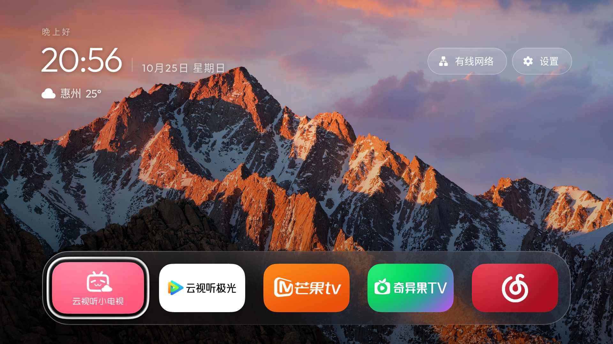

# Aerial Universal — Unofficial Derivative Build

> **This is not an original Aerial release and is not created, published, or endorsed by the upstream author.** It is a derivative build based on the open-source [Aerial project by pengchujin](https://github.com/pengchujin/aerial-tv), maintained and packaged independently by Null_. See the included upstream MIT license.

**中文说明：** [README.md](README.md) · **Installation:** [INSTALL.md](INSTALL.md) · **FAQ:** [FAQ.md](FAQ.md)

## Downloads

Get the APKs from [GitHub Releases](https://github.com/Null9797/aerial-tv-universal/releases/latest). Install only one variant: they share the same Android package name and cannot coexist.

| Variant | File | Use case |
|---|---|---|
| Standard | `aerial-universal-1.49-standard.apk` | Declares Android's regular HOME launcher entry. Try this first on Android TV / Google TV. |
| Guard | `aerial-universal-1.49-guard.apk` | Omits the HOME entry for firmware that blocks launcher packages. Follow the in-app setup and grant only permissions you understand and need. |

## What this build adds

- TV layout that adapts to the available display area, with time, date, weather, network/settings controls, and a five-app dock.
- Refined dock icon sizing and focus spacing for remote navigation.
- Flip-clock screensaver with configurable idle-to-screensaver and screensaver-to-standby delays.
- Upstream Aerial wallpaper, app organization, and screensaver capabilities.




The images are actual screenshots from an earlier Aerial custom test build on a TCL Q10G Pro, provided as representative UI examples. They were not recaptured from the current 1.49 universal APK. Weather details in the images are illustrative; device behavior and layout can vary by firmware and display.

## Installation

The detailed [installation guide](INSTALL.md) covers Android TV / Google TV developer options, common brand menus, Android 11+ wireless ADB pairing, ADB commands, and a copyable prompt for a local AI assistant that can run commands on your computer.

Short version: enable ADB debugging on the TV, connect the TV and computer to the same local network, authorize the computer on the TV, then install one APK with:

```shell
adb install -r "/path/to/aerial-universal-1.49-standard.apk"
```

Do not assume every TV uses port 5555. Android 11+ wireless debugging generally shows a pairing port and a separate connection port on the TV. See [Android's official ADB guide](https://developer.android.com/tools/adb).

## Compatibility

- Primary test device: TCL Q10G Pro.
- Other Android TV / Google TV devices have not all been verified; vendor firmware may limit launcher takeover, screensaver scheduling, or standby behavior.
- Samsung Tizen, LG webOS, and Hisense VIDAA are not Android TV platforms and cannot install this APK through Android ADB.

## Attribution and license

This derivative build is based on [pengchujin/aerial-tv](https://github.com/pengchujin/aerial-tv). The original project and its contributors retain their own copyrights. The upstream MIT license is included in [LICENSE](LICENSE). This independent build is not affiliated with the upstream author or any TV manufacturer.

## Checksums

See [SHA256SUMS.txt](SHA256SUMS.txt) to verify downloaded APK files.
