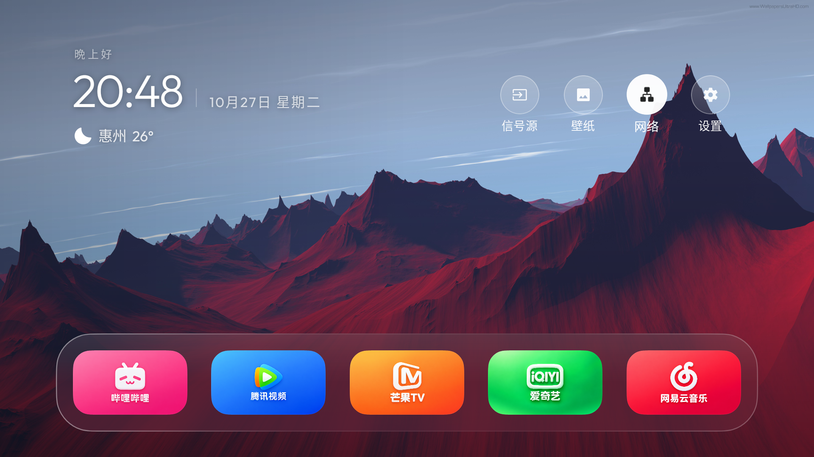

# Halo TV（基于 Aerial 二次开发）

> **重要说明：本项目并非 Aerial 原作者作品，也不是官方发行版。** 本项目基于 [pengchujin/aerial-tv](https://github.com/pengchujin/aerial-tv) 开源项目进行二次开发，由 Null_ 整理和发布。Aerial 原项目及其名称、代码和许可归原作者及各自权利人所有。本项目与 Aerial 原作者、Apple、电视厂商均无隶属或背书关系。

## 下载

前往 [Releases](https://github.com/Null9797/halo-tv/releases/latest) 下载 APK。两个版本面向不同电视固件，**同一台电视只安装其中一个**：它们使用相同应用包名，不能同时安装。

| 文件 | 版本 | 适用情形 |
|---|---|---|
| [Standard APK](https://github.com/Null9797/halo-tv/releases/download/v1.64-halo/aerial-universal-1.64-standard.apk) | 1.64-halo（versionCode 92） | 常规 Android TV / Google TV。声明标准 Android HOME 桌面入口，可通过系统界面设置默认桌面。建议先试这个版本。 |
| [Guard APK](https://github.com/Null9797/halo-tv/releases/download/v1.64-halo/aerial-universal-1.64-guard.apk) | 1.64-halo-guard（versionCode 92） | 部分国产固件会拒绝安装声明 HOME 桌面入口的应用；此版本不声明该入口，需在 Halo TV 内完成守护桌面设置，并按引导授予必要权限。 |

如果不确定，先选 **standard**。若电视明确提示不允许安装桌面类应用，再试 **guard**。从一个版本切换到另一个版本时会覆盖同包名应用；如系统提示签名或降级冲突，请停止操作并先联系维护者，不要卸载电视上的其他应用。

## Halo TV 效果展示

启动器名称与图标已改为 Halo TV；应用包名及签名保持不变，旧版可覆盖更新。APK 文件仍保留 `aerial-universal-` 前缀，以兼容已发布 1.57 内置更新器。

以下仅展示一张 Halo TV 1.58 Guard 在 TCL Q10G Pro（1920×1080）上通过 ADB 截取的桌面主页实机图。天气信息会随设备设置变化。其他尺寸、系统字体、安全区域和厂商固件可能造成外观差异。



## Halo TV 主要功能

- 1.64 基于 Aerial 1.66，合并 Halo 桌面布局与翻页时钟；新安装默认单排、每排 5 个、玻璃底板、隐藏第二排、只显示选中应用名称。
- 新安装默认翻页时钟屏保，5 分钟后启动、屏保后 10 分钟尝试进入待机，返回键不启动屏保；已有设置保留。实际待机取决于电视固件。
- 新增全屏壁纸设置与原创自然风景壁纸，保留必应每日壁纸、跟随 App、航拍与自行上传的照片和视频。

- 1.61 修复启动器图标：完整呈现 Halo TV 主题、去掉白边和黑边，并更新自适应图标及多分辨率资源。
- 在更新页面添加基于 Aerial 开源项目二次开发的非官方声明。
- 保留原包名、签名及更新器可识别的 APK 文件名前缀，以支持从 1.57 覆盖升级。
- 按可用电视显示区域自适应布局，呈现时间、日期、天气、快捷入口和五应用 Dock。
- 1.62 移除随安装包内置的 14 款应用图标以缩小体积；保留手机端自定义图标和原有在线图标库，无可用图标时沿用应用原图标或系统磁贴。图标素材后续单独分享。
- 桌面天气下方可显示可用运存和内部存储，并可在个性化设置中开关；动态壁纸新安装时默认选择“一直”，已有设置保留。
- 调整 Dock 尺寸、焦点动画和间距，保留遥控器操作空间。
- 提供 Auto、30、60、120 Hz 刷新率选项；电视不支持或系统不开放的刷新率不会被强行设置。
- 保留翻页时钟、壁纸（含视频壁纸）、屏保计时和 Aerial 上游应用整理、航拍屏保等功能。
- 应用检查 Null9797 仓库的新发布版本，下载匹配 Standard/Guard 的 APK 后交由电视系统安装器确认。更新不会静默安装；后续发布需保持同一签名证书。

完整变更见 [RELEASE_NOTES.md](RELEASE_NOTES.md)。

个别电视固件会限制第三方桌面、后台启动、屏保和待机行为；“自适应”用于按可用显示尺寸布局，不代表已在所有电视型号上验证。

## 安装

分品牌入口、ADB 连接、配对和命令行安装的完整步骤见 [INSTALL.md](INSTALL.md)。

### 方式一：让可操作本机命令行的 AI 助手安装

电脑需要安装 Android Platform Tools（含 `adb`），并与电视连接到同一个家庭网络。先在电视上开启 ADB 调试，查看电视的局域网 IP。下载本页的一个 APK 到电脑，然后把下面提示词发给能在电脑上执行命令的 AI 助手：

```text
请使用我电脑上的 Android Platform Tools，通过 ADB 帮我安装 Halo TV。
电视 IP：<电视的局域网 IP>
APK 完整路径：<下载的 APK 完整路径>
版本选择：standard 或 guard（只能选一个）

先检查 adb 是否可用、APK 文件是否存在，并尝试按电视显示的连接方式连接。
若电视出现 RSA 授权或配对码，请暂停并告诉我在电视上确认；不要尝试绕过授权。
连接后先用 adb devices 确认目标设备，再执行 adb install -r "<APK 完整路径>"。
安装成功后告诉我如何打开 Halo TV。不要卸载其他应用，不要关闭系统安全功能，
不要改默认桌面或授予持续权限，除非我另外明确要求。最后说明实际执行的命令和结果。
```

Android 11 及更新版本若电视提供 **无线调试**，通常需在电视的「无线调试 → 使用配对码配对设备」中查看配对地址、配对端口、连接端口和配对码。AI 助手可按屏幕上的值依次使用：

```bash
adb pair <电视IP>:<配对端口>
# 根据提示输入电视显示的一次性配对码
adb connect <电视IP>:<连接端口>
adb devices
adb install -r "/path/to/aerial-universal-1.64-standard.apk"
```

旧版 Android TV 或电视自带网络 ADB 常见连接方式是 `adb connect <电视IP>:5555`。端口会因 Android 版本、厂商和当前调试模式不同而变化，应以电视调试页显示的信息为准。macOS、Windows、Linux 的 Android Platform Tools 与官方 ADB 说明见 [Android Developers：ADB](https://developer.android.com/tools/adb) 和 [Run apps on a hardware device](https://developer.android.com/studio/run/device)。

### 方式二：电视上的安装器

把 APK 放进 U 盘或电视可访问的下载目录，在电视文件管理器中打开 APK，按电视提示允许本次安装。部分电视没有文件管理器、拦截第三方桌面安装，或需要厂商安装授权；此时使用上面的 ADB 方式。

### 更新提示

Halo TV 定期检查本仓库的 GitHub Releases。电视联网后，打开 Halo TV 或控制中心即可刷新检查；发现新版本时会显示提示。选择下载后仍由 Android 安装器显示确认页，需在电视上确认。只会提供与当前 Standard/Guard 变体相符的 APK。

### 设置为默认桌面与开启屏保

- **standard**：安装后按遥控器 Home 键，在系统弹出的桌面选择界面中选 Halo TV；如有“始终”选项，只有确认要长期使用 Halo TV 时才选“始终”。部分系统可在「设置 → 应用 → 默认应用 → 主屏幕应用」里更改。
- **guard**：仅当该版本的设置流程提示时，按 Halo TV 屏幕上的步骤设置守护桌面。无障碍、使用情况访问、通知监听、悬浮窗等授权会影响电视的系统行为，逐项阅读电视上的说明，只启用完成所需功能的权限。
- 屏保需在 Halo TV 设置中选择。电视系统可能另有独立屏保计时器；不同品牌对第三方屏保支持不一致。
- “屏保后进入待机”依赖 Android 和电视固件允许屏保服务结束后进入待机。该功能已在 TCL Q10G Pro 测试；其他设备不保证完整支持。

### 退出或切回原桌面

在电视「设置 → 应用 → 默认应用 → 主屏幕应用」中选回原桌面；或者清除 Halo TV 的默认桌面选择，再按 Home 重新选择。卸载 Halo TV 前先切回原桌面。不要用 ADB 删除或停用系统桌面。

## ADB 调试入口：常见 Android TV / Google TV

各品牌固件和菜单名称不同，下面是常见入口，不是所有型号的保证路径：

1. 打开电视「设置 → 系统 / 设备偏好设置 → 关于」；找到“Android TV OS build / 内部版本号 / Build”，连续按确认键约 7 次，直到显示已开启开发者选项。
2. 返回系统设置，打开「开发者选项」，启用「USB 调试」或「ADB 调试」。若提供「无线调试」，按屏幕步骤启用并记录配对端口、连接端口和一次性配对码。
3. 在电视「设置 → 网络」查看 IP。电脑和电视保持同一局域网。首次连接时在电视授权电脑的 RSA 指纹，并只对自己信任的电脑选择“始终允许”。

## 常见品牌入口（菜单随系统版本变化）

| 品牌 / 系统 | 常见入口或说明 |
|---|---|
| Google TV / 原生 Android TV、Sony BRAVIA | 设置 → 系统 / 设备偏好设置 → 关于 → Android TV OS build / 内部版本号连按约 7 次；返回「开发者选项」启用 ADB。Sony 菜单名称可能略有不同。 |
| TCL / 雷鸟（Google TV 机型） | 优先使用系统设置 → 关于 → Android TV OS build 连按约 7 次，再到「开发者选项」启用 ADB。国行旧固件菜单差异较大；只按该机型可靠说明操作。 |
| TCL 国行部分机型 | 某些固件把 ADB 放在隐藏的服务 / 工程菜单中；机型之间按键序列不通用。不要尝试其他工程选项或恢复出厂设置。若找不到可靠的本机说明，请联系厂商或使用支持 ADB 的电视盒子。 |
| 小米 / Redmi Android TV | 设置 → 关于中连续确认「产品型号」开启开发者选项；部分国行机型再到「账号与安全」启用 ADB 调试。也有机型沿用 Android TV OS build 路径。 |
| Hisense / 海信 | Google TV / Android TV 机型按通用 Android TV 路径。VIDAA 系统不是 Android TV，不能按本指南通过 ADB 安装 Android APK。 |
| OPPO / 一加电视 | 系统 / 关于本机开启开发者选项，再在开发者选项启用 USB/ADB 调试；具体触发方式依型号而异。 |
| 海尔 / 模卡、部分创维等国行电视 | 固件入口差异较大，有些机型使用厂商工程菜单。请只使用该型号的可靠说明；不要改动未知设置。 |
| Samsung Tizen、LG webOS | 不是 Android TV，不能通过 ADB 安装本项目 APK。 |

如果电视菜单没有 ADB 调试、无线调试或开发者选项，不建议尝试网上流传的通用工程码或修改系统分区。ADB 连接只应在可信的本地网络内使用；安装后可在电视开发者选项中关闭调试。

### 机型与系统支持列表

| 类别 | 机型 / 系统 | 本定制版状态 | 说明 |
|---|---|---|---|
| 已完整实测 | TCL Q10G Pro（MT5879，Android 11） | 主测试机 | 桌面、Standard/Guard 安装流程、翻页时钟等按该固件验证；其他 TCL 固件仍可能不同。 |
| 上游有设备记录，未以本定制版逐台回归 | TCL M7221 / MT9655、Xiaomi MiTV-MFTR0 / MFFU0 / MFTP0 / MTSU0 / NSOP0、CM311-1 盒子、Hisense Android TV、OPPO / Skyworth / Xgimi 等 Android TV 设备 | 可能运行，需试装 | 上游 Aerial 的设备记录不等于本定制版或这些定制功能已通过验证；桌面接管、壁纸、待机和分辨率行为看厂商固件。 |
| 不支持安装 Android APK | Samsung Tizen、LG webOS、Hisense VIDAA（非 Android 版） | 不支持 | 这些系统不是 Android TV / Google TV。 |

上表不是兼容性承诺。请先保留原桌面，优先试 Standard；遇到固件拒绝 HOME 类应用时才考虑 Guard。

## 常见问题

**Q：这是不是 Aerial 官方版？** 不是。它是基于 Aerial 上游二次开发的定制构建，非原创、非官方发行；本项目明确保留上游署名与 MIT 许可。

**Q：Guard 和 Standard 有什么区别？** Standard 声明 Android HOME 桌面入口；Guard 不声明该入口，供部分会拦截桌面类应用的固件使用。两者包名相同，不能同时安装。先试 Standard，只有遇到系统拦截时才改用 Guard。

**Q：能不能两个 APK 都装上？** 不能。它们是同一个应用的不同构建变体，会相互覆盖。

**Q：ADB 连接失败怎么办？** 检查电视和电脑是否在同一局域网、IP 是否正确、ADB/无线调试是否仍开启；Android 11+ 请使用电视当前显示的配对和连接端口，不要默认认定端口是 5555。检查电视上是否出现授权确认框。

**Q：提示 `INSTALL_FAILED_USER_RESTRICTED` 或禁止安装？** 这是电视系统或厂商安全策略拦截。先检查电视的安装确认提示和「允许通过 ADB 安装」相关设置；本项目不建议关闭通用应用验证、系统安装器或其他安全功能。不同固件的限制可能无法通过标准安装解决。

**Q：安装成功但按 Home 回到原桌面？** 在系统默认应用中选择 Halo TV。Guard 版本不是常规 HOME 入口；需按应用内设置步骤启用守护桌面，而且某些电视固件可能仍会阻止。

**Q：屏保或待机在我的电视上不生效？** 厂商对屏保调度、后台运行和待机控制的实现不同。检查 Halo TV 屏保选择、系统屏保计时和电源设置；不要期待所有 Android 电视的行为完全一致。

**Q：APK 校验值在哪里？** 查看 [SHA256SUMS.txt](SHA256SUMS.txt)，下载后可用 `shasum -a 256 <文件>`（macOS/Linux）或 `certutil -hashfile <文件> SHA256`（Windows）核对。

**Q：我想报告电视兼容问题？** 提交 Issue 时写明电视品牌、型号、Android/固件版本、所用 APK 变体和复现步骤；不要公开电视 IP、Wi‑Fi 密码、序列号、账户信息或家中二维码。

## 设备与兼容性

- **主要实测设备：TCL Q10G Pro。**
- 其他 Android TV / Google TV 设备未逐一验证，不保证桌面接管、天气、屏保调度、待机和厂商设置入口都能完整工作。
- Samsung Tizen、LG webOS、Hisense VIDAA 等非 Android 系统不支持安装此 Android APK。
- APK 不需要 root。是否启用 ADB、是否设为默认桌面和是否授权 Guard 相关权限，由用户自行决定。

## 上游项目与许可

- 上游项目：[pengchujin/aerial-tv](https://github.com/pengchujin/aerial-tv)
- 上游许可：MIT，原始许可文本随仓库提供：[LICENSE](LICENSE)
- 本仓库发布的是上游基础上的定制 APK 与说明，不代表上游作者参与、认可或维护本定制版。
- Aerial、第三方字体、天气数据、图标及媒体资产仍受各自许可或版权约束；请参阅上游项目的说明。壁纸或视频的可用性与授权依其来源而定。

更多版本选择与兼容问题见 [FAQ.md](FAQ.md)。

## 发布信息

- 版本：`1.64-halo` / `1.64-halo-guard`
- versionCode：`92`
- 最低 Android：Android 5.0（API 21）
- 构建基线：Aerial 上游 `pengchujin/aerial-tv`，上游版本 `1.66`
- 文件校验：见 [SHA256SUMS.txt](SHA256SUMS.txt)

欢迎提交兼容性反馈。使用本定制版所产生的风险由使用者自行评估；上游和发布者均不对厂商固件差异作保证。
